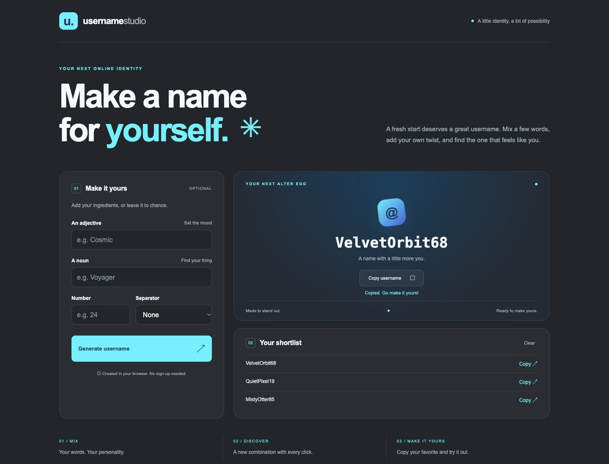

# Username Studio

A small username generator with a big personality. Redesigned in the original charcoal, cyan, and blue palette using HTML, CSS, and vanilla JavaScript.

[Live demo](https://franxis12.github.io/UserName_Generator/)



## Features

- Random adjective/noun combinations when inputs are left blank.
- Custom words, a number (including zero and leading zeros), and a separator.
- Copy the current username or any of the last eight unique suggestions.
- Clearable session shortlist and useful clipboard failure feedback.
- Responsive layout, keyboard access, and reduced-motion support.

Names are suggestions; availability is not checked with external platforms. Generation happens locally. Custom words are normalized to letters and digits for broader compatibility. Empty number fields receive a random two-digit suffix.

## Run locally

```sh
python3 -m http.server 8768
```

Open http://localhost:8768. No dependencies to install.

## Validation

JavaScript syntax checked with `node --check script.js`. Browser checks cover custom inputs, zero, random generation, clipboard feedback, history, and desktop/mobile layout.
